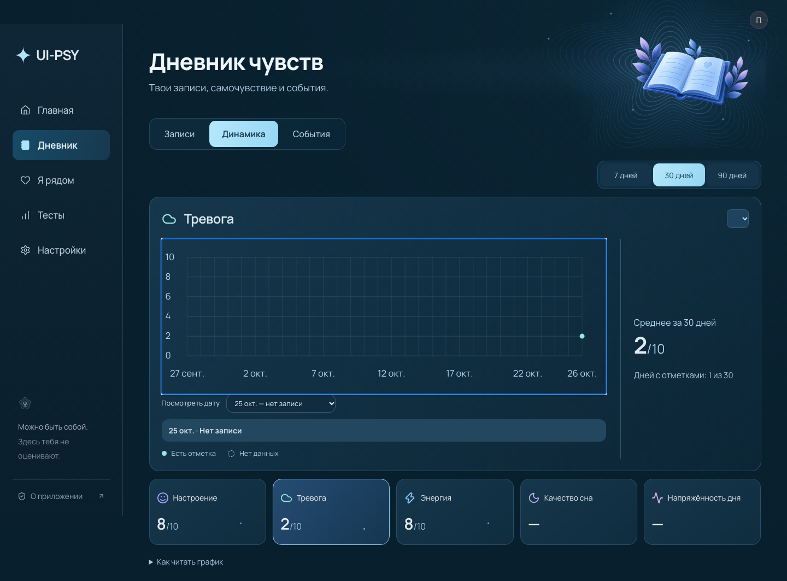

# UI-PSY

**Дневник самочувствия и пространство для бережной работы со специалистом.**

Записывай состояние, замечай изменения со временем и сохраняй важный контекст между консультациями. UI-PSY объединяет личный дневник, практики поддержки и инструменты для совместной работы пациента и специалиста.



## Что умеет приложение

- **Дневник и динамика.** Отметки самочувствия, события и наглядные графики по времени.
- **Самоподдержка.** Дыхательные практики, рефлексия, упражнения и каталог опросников.
- **Связь со специалистом.** Пациент подключается по одноразовому коду или QR и сам подтверждает доступ.
- **Рабочее пространство специалиста.** Сводка дневника, результаты назначенных опросников, планы и карточки для приёма.
- **Нейроинтерфейс.** Подключение NeuroPlay и просмотр данных ЭЭГ на совместимом устройстве.
- **ИИ-помощник.** Практики из каталога с указанием источников; отправка сообщения требует согласия пользователя.

## Технологии

| Клиент | Сервер и данные | Интеграции |
| --- | --- | --- |
| React, TypeScript, Vite | Go API, PostgreSQL | GigaChat, NeuroPlay |

## Запуск локально

Нужны Node.js **20.19+** или **22.12+**, Go **1.25+**, PostgreSQL **16+** и утилиты PostgreSQL (`createdb`, `pg_dump`, `pg_restore`).

```sh
git clone https://github.com/ArtUKnow/ui-psy.git
cd ui-psy
npm ci
cp .env.example .env.local
createdb -h /tmp ui_psy
npm run dev -- --host 127.0.0.1 --port 5178
```

Открой <http://127.0.0.1:5178>. В `.env.local` задай `DATABASE_URL`, если PostgreSQL настроен иначе. Режим разработки запускает Vite и Go API вместе; API по умолчанию доступно на порту `8178`.

Чтобы проверить production-сборку локально:

```sh
npm run build
npm run serve
```

Сервер создаёт схему базы при запуске и раздаёт собранный клиент на порту `5178`.

### ИИ-помощник

Без `GIGACHAT_CREDENTIALS` приложение работает без GigaChat, а помощник сообщает, что интеграция не настроена. Ключ добавляй только в локальный `.env.local`; не коммить его в репозиторий. Настройки провайдера и резервного копирования перечислены в [`.env.example`](.env.example).

## Проверки

```sh
npm run test:go
TEST_DATABASE_URL='postgres:///ui_psy_test?host=/tmp' npm run test:api
npx playwright test
```

Для API и браузерных тестов используй отдельные тестовые базы: сценарии очищают тестовые данные. Подробные миграционные и нагрузочные проверки описаны ниже.

<details>
<summary>Миграция, резервные копии и границы интеграций</summary>

### Миграция из SQLite

Старый Python-сервер хранится для экспорта данных и контрактных тестов; рабочий API — Go. Импорт запускается только в пустую PostgreSQL-базу.

```sh
sqlite3 server/data/ui-psy.sqlite3 ".backup server-go/private/legacy-$(date +%Y%m%d%H%M%S).sqlite3"
python3 -I scripts/export_legacy.py server-go/private/legacy-….sqlite3 server-go/private/export.json
DATABASE_URL=postgres:///ui_psy?host=/tmp server-go/bin/ui-psy --root . --import-json server-go/private/export.json
```

Экспорт содержит личные данные. Храни его вне репозитория и удаляй только после проверки переноса. `python3 -I server-go/check_migration.py` проверяет перенос на синтетических данных.

### Резервные копии

Go API периодически сохраняет PostgreSQL через `pg_dump --format=custom`. Настройки — `UI_PSY_BACKUP_INTERVAL`, `UI_PSY_BACKUP_DIR` и `UI_PSY_BACKUP_KEEP`. Локальная копия на том же диске не защищает от потери машины; для production нужны отдельное хранилище и проверенная процедура восстановления.

### Интеграции и медицинские границы

- ИИ-помощник доступен только после настройки GigaChat. Пользователь явно подтверждает отправку сообщения; дневник не передаётся автоматически. Ответы выбирают практику из ограниченного каталога. Наличие источника не доказывает клиническую корректность.
- Подключение пациента к специалисту подтверждается пациентом и может быть отключено любой стороной. Приложение само не проверяет личность или квалификацию специалиста.
- UI-PSY не ставит диагноз и не заменяет профессиональную или экстренную помощь. Для работы с реальными медицинскими данными нужны корректное согласие, подтверждение роли специалиста и защищённое развёртывание по HTTPS.

</details>
